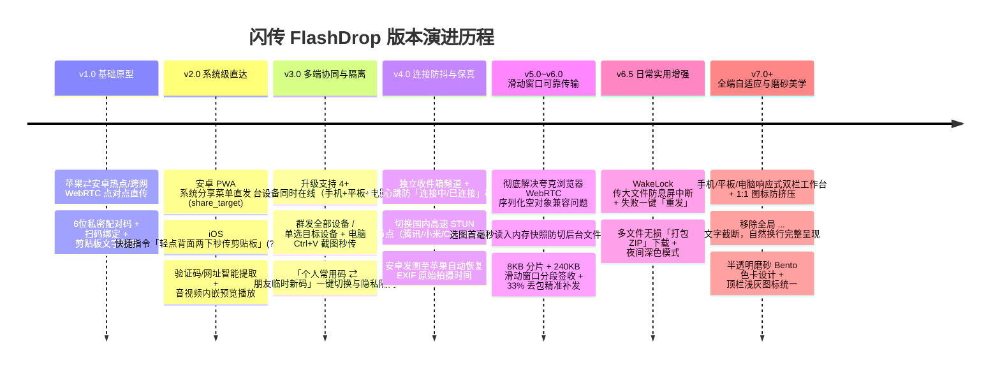

# ⚡ 闪传 FlashDrop

> **零配置 · 免安装 App · 端到端加密的跨设备极速互传 Web PWA 工具**  
> 专为 **🍎 苹果（iPhone / iPad） ⇄ 🤖 安卓（手机 / 平板） ⇄ 💻 电脑（Mac / Windows）** 打造，支持苹果开热点给安卓免流直传、同 Wi-Fi 局域网直连、以及 5G 异网穿透互传。

🌐 **在线立即使用**：[**https://bibubibu1106.github.io/flashdrop/**](https://bibubibu1106.github.io/flashdrop/)

---

## ✨ 核心亮点

- **📶 热点 / 同 Wi-Fi 零流量极速直传**：当苹果开热点给安卓（或两台设备连同一 Wi-Fi）时，自动匹配局域网内网 IP 建立 WebRTC P2P 通道，原画无损、不耗费手机流量。
- **🌍 5G 异网自动穿透与可靠中继**：当设备处于完全不同的移动网络时，自动经由国内高速 STUN 节点（腾讯 / 小米 / Cloudflare）穿透或走端到端加密滑动窗口中继。
- **📱 多设备同时在线（4+ 台设备协同）**：支持苹果手机、安卓手机、平板（iPad / 安卓平板）、电脑（Mac / Windows）同时在线，可一键 **「📡 全部设备」群发** 或 **单选指定设备私发**。
- **🔄 个人常用码 ⇄ 朋友临时码一键切换**：平时使用个人专属 6 位常用码自动秒连；分享网址给朋友时可一键生成「临时新码」面对面互传，传完一键切回个人常用码，频道与密钥 100% 隔离。
- **📋 文字 / 剪贴板秒传 & 智能提取**：
  - 自动识别文本中的 **4~8 位验证码（OTP）** 与 **网址链接**，生成「复制验证码」「打开链接」快捷按钮。
  - 支持输入框「长按粘贴即自动发送」、电脑端全局 `Ctrl+V` / `Cmd+V` 粘贴截图或文件即刻秒传。
  - 支持 iPhone 快捷指令 **`?sendText=` 轻点手机背面两下秒传剪贴板**。
- **🖼️ 原图时间保留 & 批量无损打包**：
  - 内置 JPEG EXIF 时间戳解析与恢复引擎（`exifHelper`），解决安卓发图给苹果相册后拍摄时间变成当天的问题。
  - 支持收到多张照片/多个文件后一键 **「📦 打包 ZIP」** 无损合并下载，或 iOS 一键批量存相册。
  - 支持音视频页面内直接预览播放、大文件传输防自动息屏（WakeLock）、断网一键「🔄 重发」、浅色/夜间深色模式切换。

---

## 🚀 3 步极速上手

1. **打开网页**：在需要互传的手机、平板或电脑浏览器中打开 [https://bibubibu1106.github.io/flashdrop/](https://bibubibu1106.github.io/flashdrop/)（点击右上角 **下载图标** 可查看「添加到主屏幕」引导，像原生 App 一样桌面全屏秒开）。
2. **扫码或输入配对码（仅首次需要）**：点击顶部的「配对码 / 扫码换码」，让两台设备使用同一个 **6 位配对码**（自动保存在本机，下次打开自动秒连）。
3. **开始互传**：
   - **传文字/链接/验证码**：点击「一键读取本机剪贴板并发送」或在输入框长按粘贴。
   - **传照片/视频/文件**：点击「发照片 / 视频」相册多选，或点击「发原文件 (原图)」无损保留拍摄时间与定位信息（电脑/平板可直接拖拽文件到页面或按 `Ctrl+V` 粘贴截图）。

---

## 📅 全版本演进与技术架构总结（v1.0 → v7.0+）

### 一、版本演进路线图

---

### 二、分阶段核心迭代详情

#### 🌱 v1.0：痛点破局与跨网点对点直传原型
- **解决的核心痛点**：告别通过微信/QQ「文件传输助手」中转导致的图片画质压缩、耗费双倍流量、步骤繁琐问题；解决苹果 iOS 无法免签名安装自研原生 App 的限制。
- **核心能力**：
  1. **热点免流直连 + 异网穿透双模**：苹果开热点给安卓（或连同一 Wi-Fi）时，自动匹配局域网内网 ICE 候选地址，走纯本地局域网高速直传（零流量消耗）；两边各自使用 5G 移动网络时，自动走跨网穿透或加密中继。
  2. **6 位配对码 & 二维码秒绑**：首次输入同一个 6 位配对码或相机扫码即自动记忆绑定，后续打开即连。
  3. **端到端 AES-256-GCM 加密**：所有信令握手、剪贴板文字与中继分片均通过 6 位配对码本地派生密钥（PBKDF2 + AES-256-GCM）端到端加密，公共节点无法窥探任何内容。

#### 🚀 v2.0：系统级免打开直达 & 多媒体增强
- **安卓系统级「分享直发」（`share_target` + Service Worker + IndexedDB 收件箱）**：
  - 将「闪传」添加到安卓桌面后，在系统相册、文件管理或浏览器中点击「分享」可直接选择「闪传」，无需先打开网页再选图，自动唤醒并秒传。
- **iOS「轻点背面两下秒传剪贴板」（`?sendText=` URL Scheme）**：
  - 支持 URL 参数直接触发文字秒发，配合 iPhone「快捷指令 + 辅助功能轻点背面」，实现敲两下手机背壳即可将刚复制的验证码/链接秒发给安卓或电脑。
- **剪贴板智能识别与多媒体预览**：
  - 自动识别接收文本中的 **4~8 位验证码（OTP）** 与 **网址链接**，生成「一键复制验证码」「一键打开链接」快捷按钮。
  - 支持输入框「长按粘贴即自动秒发」开关（免点发送键）。
  - 接收的视频、音频支持在页面内直接播放预览；iOS 端支持调起系统级菜单一键「存到苹果相册」。

#### 🖥️ v3.0：手机 · 平板 · 电脑多端同时在线 & 朋友临时码隔离
- **多设备 Mesh 同时在线（突破 1v1 限制）**：
  - 从最初的两台设备一对一连接，升级为支持 **iPhone + 安卓手机 + iPad/安卓平板 + Mac/Windows 电脑** 多台设备同时在线。
  - 新增顶部设备目标切换栏：既支持 **「📡 全部设备」一键群发**，也支持点击单台设备 **一对一私密选发**。
- **电脑与平板专属生产力交互**：
  - 支持文件拖拽上传（Drag & Drop）。
  - 支持电脑端截图或复制文件后，在页面任意位置直接按 **`Ctrl + V` / `Cmd + V` 粘贴秒传**手机。
- **「个人常用码 ⇄ 朋友临时新码」一键切换**：
  - 针对把网址分享给朋友使用的场景，不同配对码之间 100% 频道与密钥双隔离。
  - 配对弹窗内新增「临时新码」与「切回常用码」按钮：面对面传完文件后，点一下即可切回自己四台设备的专属常用码，无需重新输入。

#### 🛠️ v4.0：消除连接状态横跳 & 恢复苹果相册原始拍摄时间
- **根治「连接中 ⇄ 已连接」反复横跳**：
  1. **国内高速 STUN 节点替换**：移除国内网络无法连通、导致 5 秒超时卡顿的 Google STUN，切换为 **腾讯（`stun.qq.com`）、小米（`stun.miwifi.com`）与 Cloudflare** 高速节点。
  2. **独立私信收件箱频道**：每台设备订阅专属收件箱 Topic，彻底消除公共广播反射与重协商冲突。
  3. **静默后台心跳**：只要设备在线即保持绿色就绪状态，后台 P2P 握手升级不打断前端显示。
- **解决「安卓发图给苹果后拍摄时间变成今天」问题（`exifHelper.ts`）**：
  - 内置纯前端二进制 JPEG EXIF 解析与注入引擎：当安卓浏览器剥离照片 EXIF 时，自动根据文件原始时间戳（`lastModified`）在接收端无损写入标准 EXIF `DateTimeOriginal` 字段。
  - 将原文件入口明确拆分为 **「发照片 / 视频」** 与 **「发原文件 (原图)」**，引导安卓/夸克浏览器用户通过系统文件选择器保留完整原始拍摄时间与 GPS 定位。

#### 🛡️ v5.0 ~ v6.0：全链路传输可靠性重构（滑动窗口 + 夸克浏览器兼容）
针对跨网（5G 异网）及夸克浏览器传大图偶发卡进度条、显示成功但对方未收到等底层问题，完成了 4 项核心重构：
1. **修复夸克/部分安卓 WebView WebRTC 对象序列化为空 `{}` 的 Bug**：
   - 显式提取 `RTCSessionDescription.type/sdp` 与 `RTCIceCandidate.candidate/sdpMid/sdpMLineIndex` 纯字段，彻底打通苹果与夸克浏览器的 P2P 直连握手。
2. **选图首毫秒读入内存快照 + 平滑唤醒不断连**：
   - 手机切去相册选图再切回网页时，不再销毁已有连接通道；并在选择文件的第一毫秒将文件读入 `Uint8Array` 内存缓冲区，防止系统回收后台文件句柄导致传到一半中断。
3. **局域网 ICE 候选缓存队列**：
   - 解决热点直连时内网 IP 候选比 Offer 先到达而被丢弃的时序问题。
4. **v6.0 滑动窗口分段签收与漏包精准重传协议**：
   - 保底加密中继升级为 **QoS 1 + 8KB 分片 + 35ms 流控**。
   - **每 30 片（约 240KB）为一个滑动窗口**：发送方每发完一组即停下等待接收方核对；如有漏包，仅精准补发缺失分片序号，全部确认无误后再推进下一窗口，直至 100% 双向签收完成（通过 33% 随机强丢包自动化测试验证）。

#### ✨ v6.5：四大日常高频实用增强
1. **防自动息屏锁屏（Screen WakeLock API）**：页面在前台时自动申请屏幕常亮锁，防止手机传大视频中途息屏断网。
2. **传输失败 / 取消后一键「🔄 重发」**：无需重新去相册翻找文件，基于内存快照一键原地重传。
3. **多文件一键「📦 打包 ZIP」无损下载（`zipBuilder.ts`）**：收到多张照片或多个文档时，支持前端零依赖流式合成标准 ZIP 包（保留原始文件名与修改时间）一键保存。
4. **右上角深色夜间模式（Dark Mode）**：支持浅色/深色一键切换并自动记忆偏好，夜间互传不刺眼。

#### 🎨 v7.0+：全端响应式双栏工作台 & 半透明磨砂 Bento UI 全面打磨
1. **全尺寸屏幕响应式适配**：
   - 全站图标容器统一锁定 `shrink-0 aspect-square`（1:1 正方形），在任何小屏手机上绝不挤压变形。
   - **平板横屏 / 电脑宽屏（`≥ 768px`）自动切换为左右双栏工作台布局**（左侧「文字 / 剪贴板直传」，右侧「照片 / 视频 / 原文件直传」+ 双列文件网格）。
2. **零 `...` 省略号截断，全量信息自然换行**：
   - 移除全局所有 `truncate` 与 `line-clamp` 省略截断，所有标题、副标题、设备名称、连接状态提示、长文件名及剪贴板内容均完整自然换行显示。
3. **顶栏操作按钮统一与常驻**：
   - 移除配对码栏内重复的「装到桌面」文字按钮，合并为顶部栏右上角与「深色模式」「设置」视觉完全一致的**浅灰圆角方形下载图标按钮**，且在 iPhone (iOS) 与安卓端始终常驻可见。
4. **iOS 风格半透明磨砂 Bento 色卡美学**：
   - 模块标题优化为 **「文字 / 剪贴板直传」** 与 **「照片 / 视频 / 原文件直传」**。
   - 三大核心操作按钮全面升级为半透明磨砂玻璃质感（`backdrop-filter: blur(8px)`）+ 立体渐变小图标，并与左上角蓝紫 App 图标区分色系：
     - 🍯 **一键读取本机剪贴板并发送**：香槟琥珀磨砂底卡 + 暖金渐变立体图标
     - 🧊 **发照片 / 视频**：冰川晴空蓝磨砂底卡 + 亮蓝渐变立体图标
     - 🌿 **发原文件 (原图)**：薄荷翡翠绿磨砂底卡 + 翠绿渐变立体图标

---

## 🔒 隐私与安全架构

- **完全独立运行**：前端打包为零外部运行时依赖的单文件 `index.html`，托管于 GitHub Pages，任何时候打开网址即可使用。
- **端到端加密（E2EE）**：配对信令与文字/中继数据均使用基于当前 6 位配对码派生的 AES-256-GCM 密钥在设备本地加解密，服务器不留存任何用户数据。
